# claude-front

프론트엔드 개발용 개인 Claude Code 하네스. 프로젝트의 `.claude/` 디렉터리가 이 저장소의 clone 이다.

## 설치와 업데이트

```bash
git clone https://github.com/yesroad/claude-front.git .claude
echo ".claude/" >> .gitignore
```

- 프로젝트 자체 설정과 권한은 `.claude/settings.local.json`에 둔다. `settings.json`은 이 저장소 파일이라 고치면 pull 이 멈춘다.
- 세션 시작 훅이 12시간 간격으로 `git -C .claude pull --ff-only`를 백그라운드로 돌린다. 실패하면 다음 시작 때 한 줄 경고가 뜬다. 바로 받으려면 `git -C .claude pull`.

## 구조

```
.claude/
├── rules/                     // paths 에 맞는 파일을 읽거나 고칠 때만 로드. core 만 항상
│   ├── core.md                // 판단 경계(빈틈이면 멈추고 선택지 2~3개), 표기, git/커밋/PR 규약, 진입점
│   ├── react.md               // **/*.tsx - React 19 + 컴파일러 전제. 인라인 함수 금지, && 렌더링 금지, 폼 상태 한 곳
│   ├── typescript.md          // **/*.{ts,tsx} - 반환 타입 명시, Record<Union> 분기, 우회 금지, TS 6/7 델타
│   ├── nextjs.md              // app/**, proxy.ts, next.config - App Router 16 델타, 번들 문서 우선
│   ├── testing.md             // *.test.*, vitest/playwright config - GWT, 관찰 결과만 단언, Vitest 5/MSW 3 델타
│   ├── tailwind-v4.md         // **/*.css, postcss.config - @theme 토큰, @utility, v4 문법
│   ├── emotion.md             // *.styles.ts, styled.ts, registry, theme - css prop vs styled, App Router 경계
│   ├── tanstack-query.md      // queries/**, *.query.ts - queryOptions 팩토리, 키 한 곳, v5 리네임
│   ├── zod-v4.md              // schemas/**, *.schema.ts - error 파라미터, 톱레벨 포맷, 폐기 API
│   └── react-hook-form.md     // forms/**, *.form.tsx - useForm 한 곳, onTouched, 첫 에러 포커스, 미저장 이탈
├── skills/
│   ├── check/SKILL.md         // /check [scope] - /lint 게이트 → code-reviewer (+ a11y-checker) → review.md. 고치지 않는다
│   ├── lint/SKILL.md          // /lint - 컴파일러/린터가 판정한 오류의 국소 수정만. 우회 금지, 2회 실패 시 정지
│   ├── commit/SKILL.md        // /commit [scope] - lint(+test) 게이트 → commit-author 초안 → 사람 확인 → git commit -F
│   ├── test-unit/SKILL.md     // /test-unit [대상] - 순수 로직. 시나리오 합의 → 작성 → vitest --run
│   ├── test-integration/      // /test-integration [대상] - 컴포넌트+서비스, 훅+Provider. Testing Library + MSW
│   ├── test-e2e/              // /test-e2e [여정] - Playwright. getByRole 우선, storageState, page.route
│   └── web-design/            // /web-design [화면] - 톤 → HTML 목업 → 토큰 → 구현 → QA
├── agents/                    // 전부 읽기 전용(Edit, Write 없음). 스킬이 부르고 결과를 텍스트로 돌려준다
│   ├── code-reviewer.md       // opus - 상태 위치, 검증/저장 차단, 정책 값, 작성 규칙, 과도한 방어. P0/P1 + 재현 절차
│   ├── a11y-checker.md        // sonnet - 라벨/에러 연결, 키보드 경로, 포커스 관리. 키보드 재현 절차
│   └── commit-author.md       // sonnet - type(scope): 요약, 한국어 명사형, 기능 2개 이상이면 SPLIT_REQUIRED
├── workflows/
│   └── feature.js             // /feature [--autofix] [--scope x] <작업> - 계획 → 구현 → lint 게이트 → 검토 2 + 테스트 병렬 → review.md
├── hooks/
│   ├── auto-pull.sh           // SessionStart - .claude clone 을 12h 간격 pull, 실패 상태면 경고 후 재시도
│   ├── guard-pretool.sh       // PreToolUse(Bash) - 광역 rm -rf, git push --force, reset --hard, 포크밤, mkfs, dd 차단
│   └── notify.sh              // Notification(permission_prompt|idle_prompt), Stop - terminal-notifier / osascript / notify-send
├── settings.json              // 훅 등록 + 기본 허용 권한(git 조회, pnpm/npm/yarn lint, test, build)
└── _workspace/<scope>/        // gitignore - review.md(검토), commit-draft.md(커밋 초안), decisions.md(빈틈 결정)
```

## 동작

- 룰: `core.md`는 세션 시작에 로드된다. 나머지는 `paths`가 맞는 파일을 Read, Write, Edit 할 때 로드된다.
- 스킬: `/check`처럼 직접 부르거나, "방금 바꾼 거 봐줘", "커밋 메시지 만들어줘", "테스트 짜줘", "화면 만들어줘", "끝까지 한 번에"처럼 말하면 description 으로 선택된다.

```mermaid
flowchart LR
  U[사람] -->|/check| C[check] -->|게이트| L[/lint/]
  L --> CR[code-reviewer] & A[a11y-checker<br/>tsx, css 변경 시]
  CR & A --> R[(review.md)] --> U
  U -->|고친 뒤 재실행 최대 2회| C
  U -->|/commit| M[commit] -->|lint, test 게이트| CA[commit-author] --> D[(commit-draft.md)] -->|확인| G[git commit -F]
  U -->|/feature| F[feature.js] -->|계획| P{빈틈?}
  P -->|있음| Q[선택지 반환 → decisions.md] --> U
  P -->|없음| I[구현] --> L2[/lint 게이트/] --> V[code-reviewer, a11y-checker, 단위 테스트 병렬] --> R
```

- scope: 인자가 없으면 브랜치 이름에서 `feat/`, `fix/` 접두어를 뗀 것. `main`이면 `wip`. 작업 폴더는 `.claude/_workspace/<scope>/`.



- `/feature`가 멈추는 곳: 요구사항 빈틈(선택지를 돌려주고 `decisions.md`에 한 줄 적은 뒤 다시 돌린다), lint 오류가 남을 때(검토 전), 끝(수정과 커밋은 사람이 정한다). `--autofix`는 P0/P1 이 있을 때 1회 수정하고 다시 검토한다. 단위 테스트는 계획 단계의 시나리오로 쓴다.
- 검토 결과는 `review.md`에 `## 동작`, `## 접근성` 절로 남고 지적 하나는 `파일:줄` / 근거 / 재현 3줄이다.
- 훅은 매번 실행된다: 위험 명령은 실행 전에 막히고, 권한 요청과 응답 완료는 알림으로 오고, clone 은 자동으로 갱신된다.

## 프로젝트별 조정 (`.claude/settings.local.json`)

- 권한 추가: `permissions.allow`.
- 특정 룰 제외: `"claudeMdExcludes": ["**/.claude/rules/emotion.md"]`.
- 알림은 macOS `terminal-notifier`(없으면 osascript), Linux `notify-send`. `brew install terminal-notifier`.
- `/workflows`에서 실행을 `s`로 저장할 때는 개인 위치(`~/.claude/workflows/`)를 고른다. 프로젝트 위치는 이 clone 안이다.

## 개발

```bash
claude plugin validate skills --strict && claude plugin validate agents --strict
bash -n hooks/*.sh && python3 -c 'import json; json.load(open("settings.json"))'
grep -rnP '[\x{2014}\x{00B7}\x{2026}]' --include='*.md' --include='*.sh' --include='*.js' . || echo "표기 통과"
```

동작 확인은 스크래치 프로젝트에 clone 하고 `.claude/settings.local.json`에 `InstructionsLoaded` 훅(`jq -r '[.load_reason,.file_path]|@tsv' >> loaded.log`)을 둔 뒤 `claude -p --output-format stream-json`으로 시나리오를 돌려 룰 로드와 Skill, Agent, Workflow 호출 기록을 본다. `/doctor prompt-audit .claude`로 모순과 죽은 참조를 잡는다.
